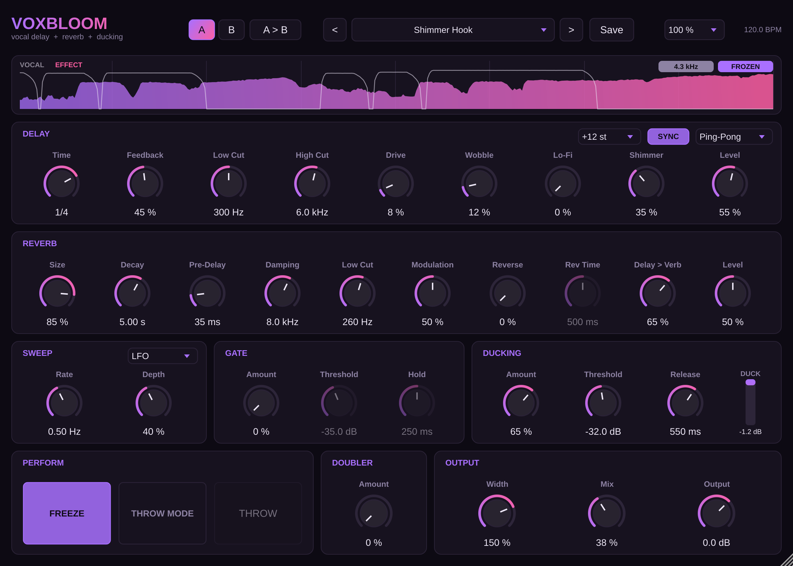

# VoxBloom

Ein Vocal-Effekt-Plugin für Delay und Hall: Echos, die nach jeder Wiederholung dunkler werden, und ein breiter Hall, der am Ende einer Zeile aufblüht und ausklingt. Ducking hält den Effekt leise, solange gesungen oder gerappt wird, und lässt ihn in den Pausen hochkommen.



Formate: **VST3** (Windows, macOS, Linux), **AU** (macOS), **Standalone**. Gebaut mit JUCE 9 und CMake.

## Signalweg

```
Vocal ─┬──────────────────────────────► Doubler ─────────────────────► Dry ─┐
       │                                                                    ├─► Mix ─► Output
       └─► Throw ─┬─► Delay (Filter, Drive, Wobble, Lo-Fi, Shimmer) ─► Level ─┐  │
                  │                        │                                ├─► Sweep ─► Width ─► Ducking ─┘
                  └────── (Delay > Verb) ──┴─► Reverb ─► Reverse ─► Gate ─► Level ─┘
                                  Freeze hält Delay und Reverb fest
```

## Regler

| Bereich | Regler | Wirkung |
|---|---|---|
| Delay | **Sync** / **Time** | Notenwert passend zum DAW-Tempo (1/32 … 1/1, punktiert und triolisch) oder frei in ms |
| | **Mode** | Stereo, Ping-Pong (Echos springen zwischen links und rechts) oder Mono |
| | **Feedback** | Anzahl der Wiederholungen |
| | **Low Cut / High Cut** | Filter, die bei jeder Wiederholung wirken: Echos werden dünner und dunkler |
| | **Drive** | Tape-Sättigung in der Rückkopplung |
| | **Wobble** | Tape-Leiern (Tonhöhenmodulation) |
| | **Lo-Fi** | Bitcrusher in der Rückkopplung: jede Wiederholung klingt dreckiger, wie Telefon oder Radio |
| | **Shimmer** / Tonhöhe | Ein Teil jeder Wiederholung wird verschoben (−12 bis +12 Halbtöne), die Echos steigen auf oder sinken ab |
| Reverb | **Size / Decay / Pre-Delay** | Raumgröße, Nachhallzeit (0,3–20 s), Abstand zwischen Stimme und Hall |
| | **Damping / Low Cut** | Höhen- und Bassanteil im Hall |
| | **Modulation** | Chorus im Hallschweif für einen weicheren Klang |
| | **Delay > Verb** | 0 %: Hall auf der trockenen Stimme, 100 %: Hall auf den Echos |
| | **Reverse** / **Rev Time** | Der Hall läuft rückwärts und schwillt in das Wort hinein; Rev Time bestimmt die Länge der Abschnitte |
| Sweep | **LFO / Envelope**, **Rate**, **Depth** | Filter auf dem Effekt. LFO: bewegt sich gleichmäßig. Envelope: folgt der Lautstärke der Stimme |
| Gate | **Amount / Threshold / Hold** | Schneidet den Hall ab, sobald die Stimme aufhört (nach der Hold-Zeit) |
| Ducking | **Amount / Threshold / Release** | Wie stark der Effekt unter der Stimme abgesenkt wird und wie schnell er danach wiederkommt |
| Perform | **Freeze** | Hält Delay und Hall endlos fest. Neue Töne kommen nicht mehr hinein |
| | **Throw Mode** + **Throw** | Mit Throw Mode hört der Effekt die Stimme nur, solange **Throw** gedrückt ist, z. B. für das letzte Wort einer Zeile. Throw lässt sich in der DAW automatisieren |
| Doubler | **Amount** | Doppelt die Stimme links und rechts (Double-Tracking) |
| Output | **Width** | Stereobreite nur des Effekts; die Stimme selbst bleibt in der Mitte |
| | **Mix** | Bis 50 % bleibt die Stimme voll da, nur der Effekt wird lauter. Über 50 % wird die Stimme leiser. |

## Presets

Zwischen den Presets wechselst du mit dem Menü oben oder mit `<` `>`. Mit **Save** speicherst du eigene Presets. Die liegen hier:

- Windows: `%APPDATA%\Drumkidbeatz\VoxBloom\Presets`
- macOS: `~/Library/Drumkidbeatz/VoxBloom/Presets`
- Linux: `~/.config/Drumkidbeatz/VoxBloom/Presets`

Mitgelieferte Presets (31):

| Kategorie | Presets |
|---|---|
| Hooks | Dark Bloom, Melodic Hook, Night Drive Echo, Dotted Dream, Shimmer Hook, Doubled Hook, Sweep Echo |
| Ad-Libs | Ad-Lib Throw, Ad-Lib Radio, Ad-Lib Octave Down, Ad-Lib Stutter |
| Throws | Tape Throw, Last Word Throw, Shimmer Throw (die letzten beiden nutzen den Throw-Button) |
| Ambient | Cloud Tail, Ambient Freeze, Halftime Space, Wide Wash, Reverse Intro, Shimmer Heaven, Fifth Cloud |
| Lo-Fi | Phone Echo, Bitcrush Echo, Old Radio |
| Creative | Gated Hall, Gated Pulse, Reverse Swell |
| Classic | Slap & Hall, Tight Room, Double & Slap |

## Bedienung

- **A / B**: Zwei Einstellungen vergleichen. Mit `A > B` kopierst du die aktuelle Einstellung in den anderen Slot. Beide werden mit dem Projekt gespeichert.
- **Fenstergröße**: Über das Menü oben rechts (75–200 %) oder durch Ziehen an der unteren rechten Ecke.
- **Anzeige**: Zeigt die letzten vier Sekunden. Die weiße Linie ist die Stimme, die farbige Fläche der Effekt, die senkrechten Linien sind Taktschläge. Ein Badge zeigt an, wenn Freeze aktiv ist oder der Sweep-Filter arbeitet.
- **Tooltips**: Mit der Maus kurz über einem Regler bleiben, dann erscheint eine Erklärung.

## Fertige Builds herunterladen

Jeder Push baut das Plugin über GitHub Actions für Windows, macOS und Linux. Unter **Actions → Build → letzter Lauf → Artifacts** findest du `VoxBloom-Windows`, `VoxBloom-macOS` und `VoxBloom-Linux`. Wenn du einen Tag wie `v1.1.0` pushst, landen die Dateien zusätzlich als Release unter **Releases**.

Enthalten:

- **macOS:** `VoxBloom-<version>-macOS.pkg` (Installer: AU, VST3 und App, einzeln abwählbar) und eine `.zip` mit denselben Dateien
- **Windows:** `VoxBloom-<version>-Windows-Setup.exe` (Installer) und eine `.zip`
- **Linux:** `.tar.gz` mit VST3 und Standalone

### macOS

Den `.pkg` per Doppelklick installieren. Der Installer legt das AU unter `/Library/Audio/Plug-Ins/Components`, das VST3 unter `/Library/Audio/Plug-Ins/VST3` und die App unter `/Applications` ab.

Solange der Build nicht signiert ist (siehe unten), blockiert macOS den Installer beim ersten Öffnen. So geht es trotzdem: Rechtsklick auf den `.pkg` → **Öffnen** → **Öffnen**. Unter neueren macOS-Versionen stattdessen **Systemeinstellungen → Datenschutz & Sicherheit → Trotzdem öffnen**.

Danach Logic Pro neu starten. In FL Studio unter **Options → Manage plugins → Find installed plugins** suchen.

### Windows

Den Setup ausführen. Das VST3 landet unter `C:\Program Files\Common Files\VST3\`. Danach in der DAW nach neuen Plugins suchen lassen. Weil der Setup nicht signiert ist, zeigt Windows SmartScreen eine Warnung: **Weitere Informationen → Trotzdem ausführen**.

## Signieren und Notarisieren (macOS)

Damit macOS den Installer ohne Warnung öffnet, muss er mit einer Apple Developer ID signiert und von Apple notarisiert sein. Dafür brauchst du eine Mitgliedschaft im Apple Developer Program (99 USD pro Jahr). Der Build ist schon vorbereitet und signiert automatisch, sobald diese Secrets im Repo hinterlegt sind (**Settings → Secrets and variables → Actions**):

| Secret | Inhalt |
|---|---|
| `MACOS_CERTIFICATE_P12` | Base64 einer `.p12`-Datei mit den Zertifikaten *Developer ID Application* und *Developer ID Installer* (`base64 -i zertifikate.p12 \| pbcopy`) |
| `MACOS_CERTIFICATE_PASSWORD` | Passwort der `.p12`-Datei |
| `MACOS_DEV_ID_APP` | z. B. `Developer ID Application: Dein Name (TEAMID)` |
| `MACOS_DEV_ID_INSTALLER` | z. B. `Developer ID Installer: Dein Name (TEAMID)` |
| `APPLE_ID` | E-Mail deines Apple-Accounts |
| `APPLE_APP_PASSWORD` | App-spezifisches Passwort von appleid.apple.com |
| `APPLE_TEAM_ID` | Deine Team-ID (10 Zeichen) |

Ohne diese Secrets wird der Build nur ad hoc signiert. Damit läuft er auf Apple Silicon, aber macOS warnt beim Öffnen.

## Selbst bauen

Benötigt: CMake 3.22 oder neuer und einen C++17-Compiler (Visual Studio 2022, Xcode oder GCC/Clang). JUCE wird beim ersten Konfigurieren automatisch heruntergeladen.

```bash
cmake -B build -DCMAKE_BUILD_TYPE=Release
cmake --build build --config Release
```

Mit `-DVOXBLOOM_COPY_AFTER_BUILD=ON` wird das Plugin nach dem Build direkt in den Plugin-Ordner kopiert. Mit `-DVOXBLOOM_JUCE_DIR=/pfad/zu/JUCE` nutzt der Build eine lokale JUCE-Kopie.

## Tests

```bash
./build/VoxBloomTests_artefacts/Release/VoxBloomTests                 # Prüfungen
./build/VoxBloomTests_artefacts/Release/VoxBloomTests --render demos  # Hörbeispiele als WAV
```

Geprüft werden: Echo-Timing (ms und Tempo-Sync), Ping-Pong-Verteilung, Echo-Pegel, Nachhallzeit, Stereobreite des Halls, Ducking, Freeze (Pegel hält, keine neuen Töne), Throw, Shimmer (Tonhöhe und Timing), Lo-Fi, Reverse, Gate, Sweep, Doubler, A/B, Stabilität und Pegel aller Presets, Speichern und Laden (Session und User-Presets), gleiche Ergebnisse bei unterschiedlichen Blockgrößen, Mono-Betrieb und CPU-Last.

## Lizenz

JUCE steht unter AGPLv3 oder der kommerziellen JUCE-Lizenz. Wenn du das Plugin verkaufen oder als Closed Source veröffentlichen willst, brauchst du eine passende JUCE-Lizenz. Für den Eigengebrauch ist das nicht nötig.
